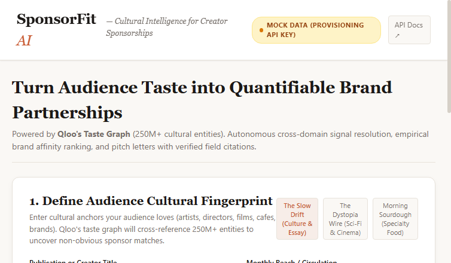

# SponsorFit: Cultural Intelligence for Creator Sponsorships

> **Turn audience cultural taste into quantifiable brand partnerships.**  
> Built for the **Qloo Agentic Hackathon: "Agents, but with taste"** (April 2026).



---

## 1. Problem & Executive Pitch

Independent newsletter publishers, podcasters, and boutique media creators struggle to win brand sponsorships. They send pitch decks citing basic, flat metrics ("we have 35,000 monthly listeners aged 25–40"), competing against algorithmic ad exchanges. Meanwhile, premium brands (e.g., Oatly, Aesop, Patagonia, Kinto) seek authentic cultural alignment but have no empirical method to verify whether a creator's niche audience truly overlaps with their brand values.

**SponsorFit** solves this with an autonomous cultural intelligence agent powered by **Qloo's Taste Graph** (250M+ entities across music, film, literature, dining, and brand domains):

1. **Entity Resolution (`/search`):** Ground creator audience affinity seeds into canonical Qloo URN entities.
2. **Taste Graph Ingestion (`/v2/insights`):** Query high-confidence cross-domain brand affinities and explainability drivers.
3. **Deterministic Ranking Engine:** Rank prospective sponsors by empirical affinity multipliers against general population baselines ($A_i / \bar{A}$).
4. **Cultural Media Kit & Grounded Pitch Writer:** Generate actionable brand pitches and one-page media kits where **every single statistic cites an exact response field from Qloo's API**—eliminating hallucination.

---

## 2. API Provisioning Disclosure ("Mock Until Key")

> **Current Status:** Qloo Hackathon API keys are provisioned manually by hackathon organizers.  
> SponsorFit includes a **transparent, production-identical mock layer** that defaults to offline mode when `QLOO_API_KEY` is omitted or empty.

- **Offline Mode:** The UI displays a prominent amber badge (`MOCK DATA (PROVISIONING API KEY)`). All shapes, URNs, affinity scores, and explainability signals exactly mirror the official Qloo LLM Hackathon OpenAPI specification (`https://hackathon.api.qloo.com`).
- **Live Mode:** Once your hackathon API key is issued, set `QLOO_API_KEY=your_key` in `.env`. The client immediately switches to live queries against `https://hackathon.api.qloo.com` using the required `X-Api-Key` header with zero code changes.

---

## 3. Quickstart & Local Setup

### Prerequisites
- Node.js 18+ (tested on Node 20 / 22 / 24)
- npm 9+

### Installation & Run

```bash
# 1. Install dependencies
npm install

# 2. Configure environment (optional, defaults to mock mode)
cp env.example .env
# Edit .env if you have a Qloo Hackathon API key:
# QLOO_API_KEY=your_key_here

# 3. Run unit & integration test suite (13 tests)
npm test

# 4. Start local development server (Vite dev server + embedded API mock middleware)
npm run dev
```

Visit [http://localhost:5173](http://localhost:5173) in your browser.

### Building for Production

```bash
# Compile TypeScript and bundle frontend SPA
npm run build

# Preview production build
npm run preview
```

---

## 4. Agent Architecture & Zero Hallucination Guarantee

```
  [User Cultural Seeds]
      (e.g., A24, Phoebe Bridgers, Severance, Tartine Bakery)
               │
               ▼
┌────────────────────────────────────────────────────────┐
│ Step 1: Entity Resolution (qloo_search_entities)       │
│ Endpoint: /search?query=...&types=...                  │
│ Output: Canonical URNs (e.g. urn:entity:movie:...)     │
└────────────────────────────────────────────────────────┘
               │
               ▼
┌────────────────────────────────────────────────────────┐
│ Step 2: Taste Graph Traversal (qloo_get_insights)      │
│ Endpoint: /v2/insights                                 │
│ Params: filter.type=urn:entity:brand                   │
│         signal.interests.entities=<URNs>               │
│         feature.explainability=true                    │
│ Output: Brand affinities & cross-domain fingerprints   │
└────────────────────────────────────────────────────────┘
               │
               ▼
┌────────────────────────────────────────────────────────┐
│ Step 3: Deterministic Ranking Engine                   │
│ Math: Multiplier = round(affinity / baseline, 1)       │
│ Sorting: Descending affinity, confidence weighting     │
└────────────────────────────────────────────────────────┘
               │
               ▼
┌────────────────────────────────────────────────────────┐
│ Step 4: Grounded Media Kit & Pitch Letter Writer       │
│ Strict Provenance: Every statistic links to:           │
│   • results.entities[i].affinity                       │
│   • results.entities[i].query.explainability.signals   │
│   • results.entities[i].tags                           │
└────────────────────────────────────────────────────────┘
```

### Exact Provenance Citations
Every pitch letter and media kit bullet highlights its underlying Qloo response field:
- **Affinity Score:** `results.entities[i].affinity` (e.g., `0.94`)
- **Index Multiplier:** Derived against population baseline `baseline` (e.g., `4.1x`)
- **Driver Signal:** `results.entities[i].query.explainability.signals[j].influence` (e.g., `+34%`)
- **Category Alignment:** `results.entities[i].tags` (e.g., `specialty-coffee`, `editorial`)

---

## 5. Deployment Options

1. **Vite SPA (Static Distribution):**
   Run `npm run build` to emit production assets to `dist/`. Deploy directly to Cloudflare Pages, Netlify, or Vercel.
2. **Framework-Neutral Edge / Serverless API:**
   `api/handler.mjs` exports a standard `(Request) => Promise<Response>` handler compatible with:
   - Cloudflare Workers
   - Vercel Edge Functions
   - AWS Lambda (via adapter)
   - Node.js `http.createServer` (via `api/server.mjs`)

---

## 6. Verification & Test Evidence

Run tests anytime with:
```bash
npm test
```

### Verified Suite:
- `api/qloo-client.test.mjs`: Tests mock fallback, custom base URL, API key header injection, error handling.
- `api/agent.test.mjs`: Tests full 4-step autonomous audit pipeline, ranking sorting, pitch provenance field generation.
- `api/handler.test.mjs`: Tests HTTP routing, health endpoint, audit payload execution, and CORS handling.
- **Result:** 13 passed, 0 failed.

---

## 7. License

MIT License. Designed and crafted for the Qloo Hackathon 2026.
