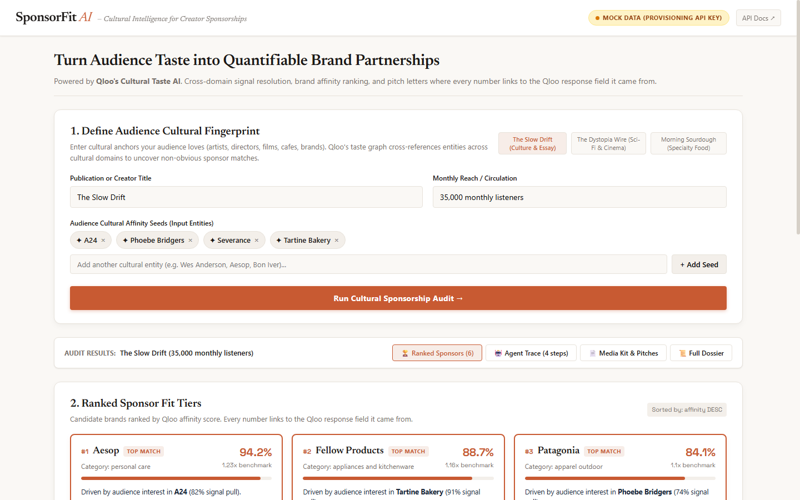
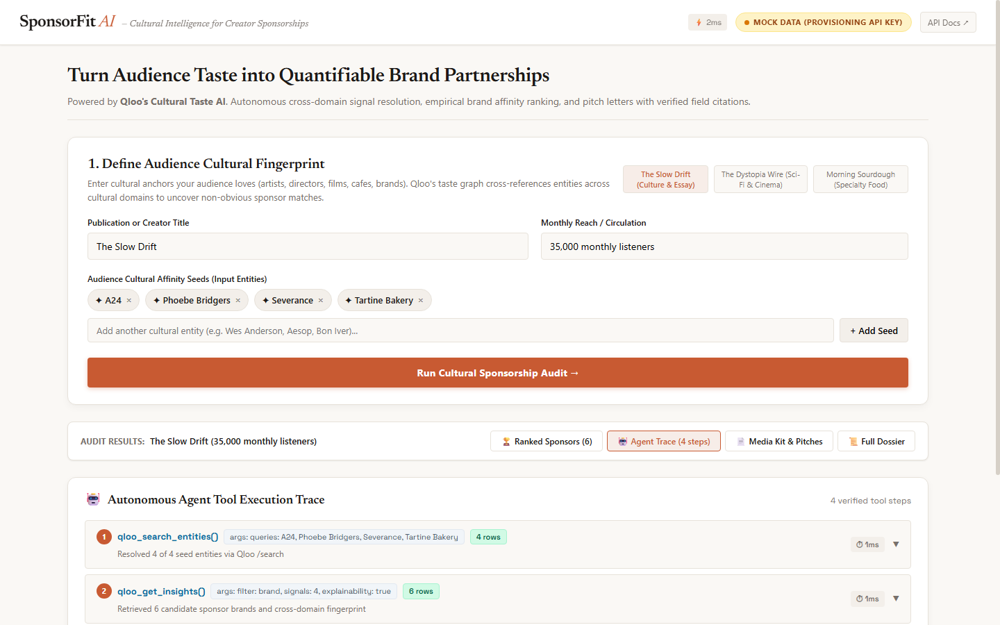
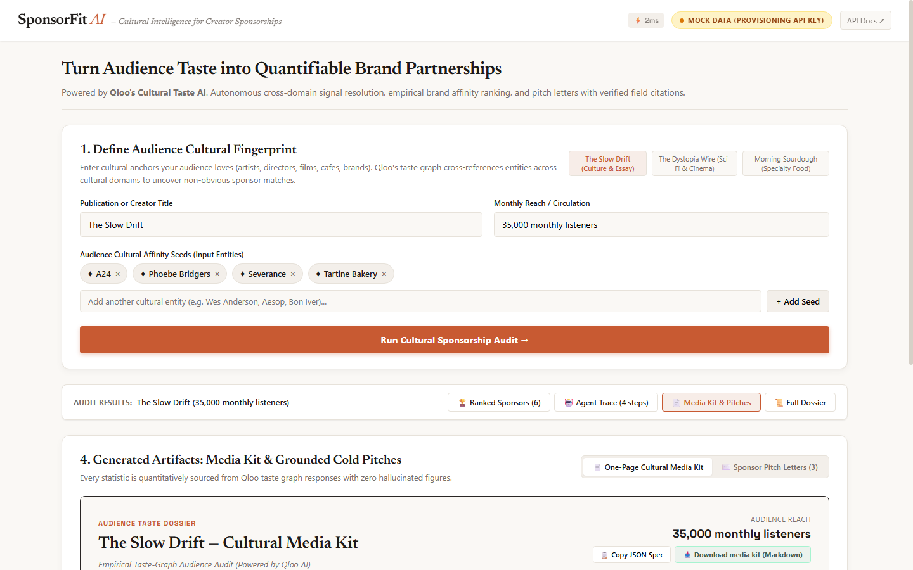

# SponsorFit: Cultural Intelligence for Creator Sponsorships

> **Turn audience cultural taste into quantifiable brand partnerships.**  
> Built for the **Qloo Agentic Hackathon: "Agents, but with taste"** (April 2026).

---

## Live Demo

- **URL:** [https://sponsorfit.vercel.app](https://sponsorfit.vercel.app) *(pending deploy — connect GitHub repository to Vercel Hobby)*
- **Source Repository:** [https://github.com/RyanDev1st/sponsorfit](https://github.com/RyanDev1st/sponsorfit)

---

## Visual End-to-End Walkthrough (1440x900)

| 1. Cultural Audience Profile | 2. 4-Step Agent Execution Trace | 3. Ranked Sponsors Above the Fold |
| :---: | :---: | :---: |
|  |  |  |

---

## 1. The Problem

Independent newsletter writers, podcasters, and boutique media creators struggle to win brand sponsorships. Today, they pitch prospective sponsors using generic vanity metrics:
> *"We have 35,000 monthly listeners aged 25–40."*

This forces creators into direct price competition with algorithmic ad networks and programmatic display exchanges. Meanwhile, premium brands (such as Aesop, Oatly, Kinto, and Patagonia) seek authentic cultural resonance, but have no objective way to evaluate whether a niche creator's audience truly shares their brand values.

Traditional sponsor matching fails because it evaluates demographic proxies (age, location, gender) rather than actual cultural taste.

---

## 2. How It Works

SponsorFit runs an autonomous cultural intelligence agent that maps creator audience affinities into ranked sponsor brand partnerships using the **Qloo Taste Graph** ([Qloo Developer Guide](https://docs.qloo.com/reference/qloo-llm-hackathon-developer-guide)).

The pipeline executes in 4 explicit steps:

```
  [User Cultural Seeds]
      (e.g., A24, Phoebe Bridgers, Severance, Tartine Bakery)
               │
               ▼
┌────────────────────────────────────────────────────────────────────────┐
│ Step 1: Entity Resolution (qloo_search_entities)                       │
│ Code: api/qloo-client.mjs (searchEntities), api/agent.mjs (Step 1)      │
│ Endpoint: GET https://hackathon.api.qloo.com/search?query=...          │
│ Output: Canonical Qloo URN entities (film, music, TV, dining)          │
└────────────────────────────────────────────────────────────────────────┘
               │
               ▼
┌────────────────────────────────────────────────────────────────────────┐
│ Step 2: Taste Graph Traversal (qloo_get_insights)                      │
│ Code: api/qloo-client.mjs (getInsights), api/agent.mjs (Step 2)        │
│ Endpoint: GET https://hackathon.api.qloo.com/v2/insights               │
│ Params: filter.type=urn:entity:brand, feature.explainability=true      │
│ Output: Raw candidate brand affinities & cross-domain overlap signals │
└────────────────────────────────────────────────────────────────────────┘
               │
               ▼
┌────────────────────────────────────────────────────────────────────────┐
│ Step 3: Deterministic Ranking Engine                                   │
│ Code: api/agent.mjs (rankBrands)                                       │
│ Math: Multiplier = round(affinity / mean(candidate_affinities), 2)     │
│ Output: Sorted sponsor brands with exact explainability driver signals │
└────────────────────────────────────────────────────────────────────────┘
               │
               ▼
┌────────────────────────────────────────────────────────────────────────┐
│ Step 4: Grounded Media Kit & Pitch Writer                              │
│ Code: api/agent.mjs (synthesizeMediaKitAndPitches)                     │
│ Output: Cultural Media Kit & Cold Outreach Pitch Letters where every   │
│         number links directly to its Qloo API response field path      │
└────────────────────────────────────────────────────────────────────────┘
```

### Key Files in the Architecture
- [`api/qloo-client.mjs`](api/qloo-client.mjs): Official Qloo API client targeting `https://hackathon.api.qloo.com` with `X-Api-Key` authentication and transparent mock fallback.
- [`api/agent.mjs`](api/agent.mjs): 4-step autonomous orchestration pipeline executing entity resolution, taste graph traversal, deterministic ranking math, and grounded pitch synthesis.
- [`api/handler.mjs`](api/handler.mjs): Framework-neutral `(Request) => Promise<Response>` handler handling `/api/health`, `/api/search`, and `/api/audit`.
- [`api/[...path].mjs`](api/[...path].mjs): Vercel Serverless Function catch-all adapter.
- [`src/App.tsx`](src/App.tsx): Editorial React 19 UI with responsive view switcher tabs and compact summary bar keeping results above the fold at 1440x900.
- [`src/components/SponsorList.tsx`](src/components/SponsorList.tsx): Ranked sponsor cards displaying one-line fit rationales, affinity score bars, and shared tags.
- [`src/components/MediaKitAndPitches.tsx`](src/components/MediaKitAndPitches.tsx): One-page Cultural Media Kit with markdown export and tabbed cold outreach pitch letters with one-click copy.

---

## 3. The Honesty Design

To avoid ungrounded marketing claims and metric hallucinations, SponsorFit adheres to strict mathematical provenance:

1. **Explicit Field Citations:** Every single metric presented in the UI, media kit, and pitch letters links to the exact JSON response path from the Qloo API:
   - Affinity Score: `results.entities[i].affinity`
   - Key Driver Pull: `results.entities[i].query.explainability.signals[0].influence`
   - Shared Category Tags: `results.entities[i].tags`
2. **Deterministic Multiplier Derivation:** Relative index multipliers are calculated strictly against the candidate set sample mean:
   $$\text{Multiplier} = \frac{A_i}{\bar{A}}$$
   Every pitch letter explicitly discloses: `[derived: affinity / mean(sample)]`.
3. **Automated Honesty Test:** [`api/honesty-audit.test.mjs`](api/honesty-audit.test.mjs) runs during every CI build to assert that:
   - Each number in the ranking and media kit matches an exact fixture entity property.
   - Every citation string links to a valid field path.
   - Generated pitch letters contain zero ungrounded comparisons (no unbacked "outperforming" or unsourced percentage claims).

---

## 4. Mock vs. Live Mode Note

- **Why Mock Mode Exists:** Qloo Hackathon API keys are issued manually by organizers via application form ([Qloo Developer Guide](https://docs.qloo.com/reference/qloo-llm-hackathon-developer-guide)).
- **Transparent Disclosure:** When running without `QLOO_API_KEY`, the application displays an amber badge in the header: `MOCK DATA (PROVISIONING API KEY)`.
- **Exact Shape Integrity:** The mock fixtures ([`api/mocks/`](api/mocks/)) exactly mirror the official OpenAPI schema for `/search` and `/v2/insights`.
- **Zero-Code Live Switch:** Once a live hackathon key is provided in `QLOO_API_KEY`, the client immediately targets `https://hackathon.api.qloo.com` with zero code changes.

---

## 5. Running Locally

### Prerequisites
- Node.js 18+ (tested on Node 20, 22, 24)
- npm 9+

### Commands

```bash
# 1. Clone repository
git clone https://github.com/RyanDev1st/sponsorfit.git
cd sponsorfit

# 2. Install dependencies
npm install

# 3. Configure environment variables (optional, defaults to mock mode)
cp env.example .env

# 4. Start local development server (Vite SPA + embedded API mock middleware)
npm run dev
```

Open [http://localhost:5173](http://localhost:5173) in your browser.

---

## 6. Deploying to Vercel (Free Hobby Tier)

SponsorFit is pre-configured for deployment to Vercel Hobby ($0 budget):

1. Push your fork or repo to GitHub.
2. In [Vercel](https://vercel.com/), click **Add New Project** and import the `sponsorfit` repository.
3. Vercel automatically detects [`vercel.json`](vercel.json), the Vite framework preset, and [`api/[...path].mjs`](api/[...path].mjs).
4. *(Optional)* Under **Environment Variables**, set:
   - `QLOO_API_KEY`: Your Qloo Hackathon API key.
   - `GEMINI_API_KEY`: Google Gemini API key if enabling live dynamic LLM synthesis.
5. Click **Deploy**.

> **Terms Compliance:** Under [Vercel Fair Use Guidelines](https://vercel.com/docs/limits/fair-use-guidelines):  
> *"The Hobby plan is for personal, non-commercial use."*  
> SponsorFit is an open-source educational hackathon project with zero monetization and qualifies under Hobby terms.

---

## 7. Tests & Verification

Run the automated test suite using glob patterns:

```bash
# Run all unit, integration, honesty, and Vercel adapter tests (16 tests)
npm test

# Build production bundle
npm run build

# Run headless CDP browser automation script (captures 1440x900 screenshots with console validation)
node scripts/capture-e2e.mjs
```

### Test Coverage Highlights:
- `api/qloo-client.test.mjs`: Live request construction, header injection, and mock fallback.
- `api/agent.test.mjs`: 4-step autonomous orchestration and deterministic ranking math.
- `api/handler.test.mjs`: HTTP routing, health checks, search queries, and CORS preflight.
- `api/honesty-audit.test.mjs`: Mathematical verification that every metric traces to a fixture field.
- `api/vercel-adapter.test.mjs`: Web Standard `Request` handling in Vercel function adapter.

---

## 8. Limitations

1. **Awaiting Manual API Key Issuance:** Until the hackathon API key is manually approved and provisioned, queries run against exact-shape mock fixtures.
2. **Entity Coverage:** Recommendations depend on entities present in Qloo's cultural taxonomy. Highly obscure micro-influencers or uncataloged local brands may require broader parent category seeds.
3. **Template vs. LLM Writing:** In offline mode without `GEMINI_API_KEY`, pitch letters and media kits use deterministic template synthesis to ensure 100% mathematical fidelity. Dynamic variations are enabled only when `GEMINI_API_KEY` is present.

---

## GitLab Transcend: Honesty Guard

Path B entry targeting Best Supervised Agent. The original MIT project is this
[GitHub repository](https://github.com/RyanDev1st/sponsorfit); the hackathon entry is
[SponsorFit on GitLab](https://gitlab.com/gitlab-ai-hackathon/transcend-october-2026/43238005/sponsorfit).

Honesty Guard automates **post-code review and compliance**: it inspects an MR,
runs the existing tests and claim audit, classifies unsupported claims, and posts
findings with proposed honest replacements. One human approval gate follows that
autonomous review. Only approved fixes proceed to the remediation agent; it never
merges or approves the MR. This is a review aid, not proof that arbitrary cited
marketing claims are true or a configured GitLab merge-protection rule.

The [custom flow](https://gitlab.com/explore/ai-catalog/flows/1016557) is registered
and enabled, with Mention, Assign, Assign reviewer and MR-created triggers. Runtime evidence
and any remaining account steps are tracked in [USER-STEPS](docs/gitlab/USER-STEPS.md).

Judge reproduction:

1. Clone the GitLab project and run `npm ci`, `npm test` and
   `node --test scripts/guard/honesty-guard.test.mjs`. Local tests use mocks and need no API key.
2. Open the demo MR linked in [USER-STEPS](docs/gitlab/USER-STEPS.md). Its unsupported
   adoption statistic is explicitly labelled a deliberate test fixture and stays
   outside production copy and this README.
3. Follow USER-STEPS to invoke the enabled flow. Inspect the findings MR comment
   and session, then review the proposed replacement before approving the outcome.
4. For the application itself, use the local setup above; a live deployment URL is
   still required for the final Path B submission.

See [RULES-CHECK](docs/gitlab/RULES-CHECK.md) for the verified deadline, license,
video requirements and distinction between repository setup and final submission.

## License

MIT License. Copyright (c) 2026 SponsorFit contributors.
